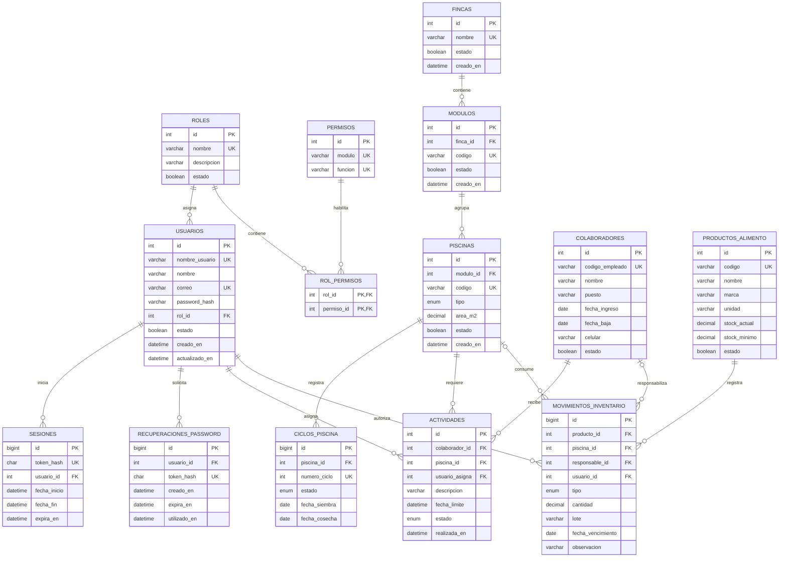

# Diagrama Entidad–Relación — Pacific Gold

**Versión:** 1.0 — estructura actual del sistema  
**Base de datos:** `pacific_gold` (MariaDB)

> Este diagrama representa las entidades implementadas actualmente. Debido a que
> el proyecto se desarrolla de forma incremental, deberá actualizarse cuando se
> incorporen nuevas entidades o relaciones.

## Leyenda

- **PK:** clave primaria que identifica cada registro.
- **FK:** clave foránea que relaciona una tabla con otra.
- **UK:** campo o combinación de campos con valor único.
- `||--o{`: relación de uno a muchos.
- `o|--o{`: relación opcional de uno a muchos.

## Organización del modelo

1. **Seguridad:** roles, permisos, usuarios, sesiones y recuperaciones.
2. **Producción:** fincas, módulos, piscinas y ciclos de piscina.
3. **Personal:** colaboradores y actividades.
4. **Inventario:** productos de alimento y movimientos de inventario.

El código productivo como `EM00-PC1-5` no se almacena en una columna duplicada:
la aplicación lo presenta concatenando el código de la piscina y el número del
ciclo correspondiente.
